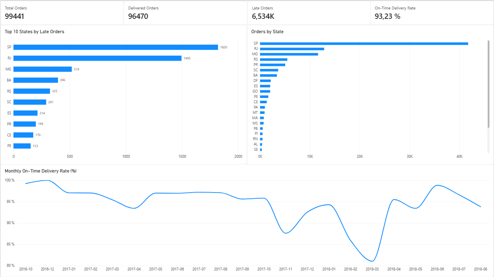
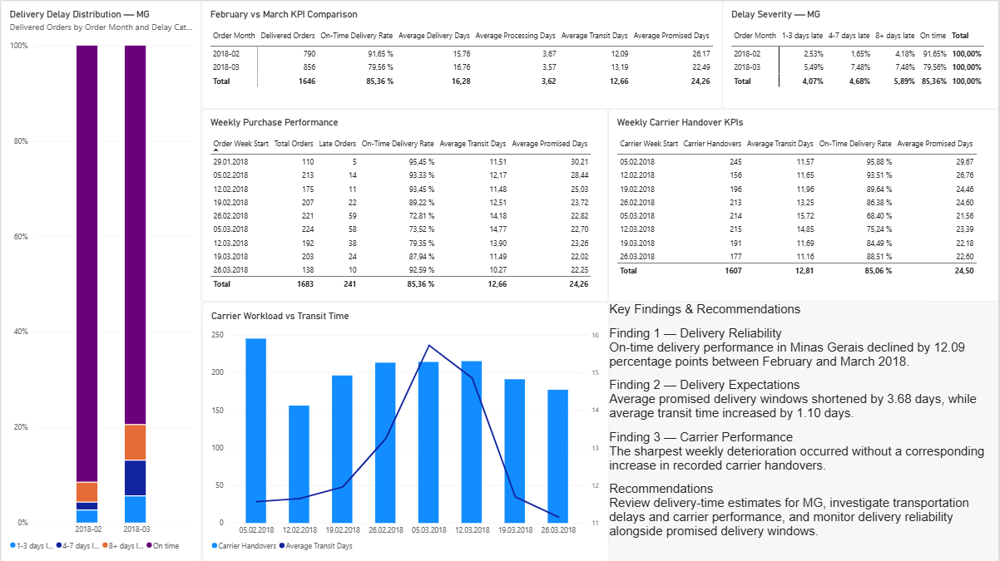

# E-Commerce Delivery Performance Analysis

### End-to-End Business Intelligence Project | Power BI & SQL

**Tools:** Power BI · Power Query · DAX · SQL (SQLite) · Data Modeling · Business Analytics

## 1. Project Overview

This project analyzes e-commerce order fulfillment and delivery performance using the Brazilian Olist E-Commerce dataset, containing approximately 100,000 orders.

The objective is to evaluate delivery reliability, identify regional performance differences, investigate delivery delays, and provide data-driven recommendations for improving logistics operations.

The project combines data transformation, relational data modeling, DAX calculations, interactive dashboards, and independent SQL validation.

## 2. Business Problem

A successful e-commerce business needs to deliver orders reliably while maintaining realistic delivery promises.

This analysis focuses on five key questions:

1. What percentage of orders are delivered on time?
2. Which Brazilian states experience the most delivery delays?
3. How has delivery performance changed over time?
4. What factors are associated with the deterioration in delivery reliability?
5. What operational improvements should management investigate?

## 3. Dataset

**Source:** [Brazilian E-Commerce Public Dataset by Olist — Kaggle](https://www.kaggle.com/datasets/olistbr/brazilian-ecommerce)

**Period:** 2016–2018

**Total orders:** 99,441

The dataset includes information about orders, customers, sellers, products, payments, reviews, and delivery timestamps.

Nine source CSV files were loaded into Power BI. The delivery KPIs and the SQL validation in this case study primarily use **`olist_orders_dataset`** and **`olist_customers_dataset`**. The other imported tables remain available for further analysis.

The original dataset is publicly available through Kaggle.

## 4. Methodology

### Data Preparation — Power Query

- Imported raw CSV datasets.
- Validated column data types and missing values.
- Classified orders by delivery status.
- Calculated delivery duration.
- Prepared delivery-related fields for further analysis.

### Data Modeling — Power BI

- Connected related tables using their respective keys.
- Established table relationships for cross-filtering.
- Created calculated columns and DAX measures.
- Developed interactive analytical reports.

### SQL Validation

Used SQLite to independently validate key Power BI calculations through:

- SELECT, WHERE, GROUP BY, ORDER BY
- INNER JOIN
- CASE WHEN
- Common Table Expressions (CTEs)
- Conditional aggregation
- Date-based analysis

## 5. Executive Dashboard

[Download the Power BI Dashboard](PowerBI/Olist_Delivery_Analytics.pbix)

The dashboard provides a nationwide overview of delivery performance.

### Key Performance Indicators

| KPI | Result |
|---|---:|
| Total Orders | 99,441 |
| Delivered Orders (valid delivery dates) | 96,470 |
| On-Time Orders | 89,936 |
| Late Orders | 6,534 |
| On-Time Delivery Rate | 93.23% |

The on-time delivery rate is calculated as:

**On-Time Orders / (On-Time Orders + Late Orders) × 100**

Undelivered orders and delivered orders without sufficient date information are excluded from this metric.

### Regional Findings

São Paulo accounted for the largest number of orders and achieved a 95.51% on-time delivery rate.

Rio de Janeiro had a substantially lower rate of 87.89%, indicating an opportunity for further logistics investigation.

São Paulo and Rio de Janeiro together accounted for approximately 50.7% of all late orders.

## 6. Root Cause Analysis — Minas Gerais

A significant deterioration in delivery performance was identified in Minas Gerais between February and March 2018.

### Monthly Performance Comparison

| Metric | February 2018 | March 2018 |
|---|---:|---:|
| Delivered Orders | 790 | 856 |
| Late Orders | 66 | 175 |
| On-Time Delivery Rate | 91.65% | 79.56% |
| Average Delivery Days | 15.76 | 16.76 |
| Average Processing Days | 3.67 | 3.57 |
| Average Transit Days | 12.09 | 13.19 |
| Average Promised Days | 26.17 | 22.49 |

### Key Finding 1 — Delivery Reliability

The on-time delivery rate decreased by **12.09 percentage points**, while the number of late orders increased from 66 to 175.

### Key Finding 2 — Delivery Expectations

Average promised delivery windows decreased by 3.68 days, while actual delivery times increased by 1 day.

Consequently, the difference between average promised and actual delivery time decreased by approximately 4.68 days.

### Key Finding 3 — Transportation Performance

Average processing time improved slightly, decreasing by 0.10 days.

However, average transit time increased by 1.10 days, suggesting that transportation performance was an important area for investigation.

### Key Finding 4 — Delay Severity

The share of deliveries delayed by 4–7 days increased from 1.65% to 7.48%.

This category represented the largest increase among the delay-severity groups.

### Key Finding 5 — Carrier Handover Analysis

Between the weeks beginning February 26 and March 5:

- Carrier handovers remained nearly unchanged: 213 versus 214.
- Average transit time increased from 13.25 to 15.72 days.
- On-time delivery performance declined from 86.38% to 68.40%.

These findings suggest that changes in recorded handover volume alone do not explain the deterioration.

However, the dataset does not include total carrier workload or capacity utilization, so actual capacity constraints cannot be ruled out.

## 7. Business Recommendations

Based on the analysis, the following actions are recommended for further evaluation:

**1. Review Delivery-Time Estimates**

Evaluate whether promised delivery windows accurately reflect expected transportation times in Minas Gerais.

**2. Investigate Transportation Performance**

Examine delivery routes, seller locations, shipment handling, and potential logistics bottlenecks.

**3. Monitor Delivery Performance**

Track on-time delivery rates, average transit days, promised delivery windows, and delay severity together.

**4. Prioritize High-Impact Regions**

Consider both late-delivery rates and the absolute number of affected orders when allocating operational resources.

## 8. SQL Validation

Five SQL scripts were created to validate calculations independently of Power BI.

| SQL File | Purpose |
|---|---|
| `01_delivery_classification.sql` | Classify orders by delivery status |
| `02_national_kpi.sql` | Calculate the national on-time delivery rate |
| `03_orders_by_state.sql` | Analyze order volume using JOIN |
| `04_regional_performance.sql` | Compare regional delivery KPIs |
| `05_mg_analysis.sql` | Validate February–March performance in Minas Gerais |

The main results calculated in SQLite matched the corresponding Power BI results.

## 9. Limitations

- The analysis uses historical 2016–2018 data and does not represent current Olist performance.
- Delivery performance is measured against estimated delivery dates.
- Delivery data does not provide complete visibility into individual carrier operations or available capacity.
- Observed relationships between delivery promises, transit times, and punctuality should not be interpreted as proof of causation.
- Changes in seller distribution, customer locations, transportation routes, or order mix may also influence performance.

## 10. Project Structure

**PowerBI/**

- Olist_Delivery_Analytics.pbix

**SQL/**

- 01_delivery_classification.sql
- 02_national_kpi.sql
- 03_orders_by_state.sql
- 04_regional_performance.sql
- 05_mg_analysis.sql
- Olist_Portfolio.db
- Olist_SQL_Project.sqbpro

**Screenshots/**

- Executive_Overview.png
- Root_Cause_Analysis.png

**README.md** — Project documentation

**RawData/** — Original Olist CSV files (local; download from Kaggle)

## 11. Reproducing the Analysis

1. Download the original dataset from the [Olist Kaggle page](https://www.kaggle.com/datasets/olistbr/brazilian-ecommerce).
2. Place the original CSV files in a local `Olist-Ecommerce-Analytics/` folder.
3. Open `PowerBI/Olist_Delivery_Analytics.pbix` in Power BI Desktop.
4. For SQL validation, open DB Browser for SQLite, import `olist_orders_dataset.csv` and `olist_customers_dataset.csv` as tables, and enable **Column names in first line**.
5. Run the scripts in `SQL/` to reproduce the delivery classification, nationwide KPI, regional results, and Minas Gerais monthly comparison.

The SQLite database itself is not required in this repository; it can be recreated from the original CSV files. The `.pbix` file is the editable report, while the screenshots can be viewed directly on GitHub without Power BI.

## 12. Conclusion

This project demonstrates an end-to-end business intelligence workflow, from raw data preparation to interactive reporting and SQL validation.

The analysis identified regional delivery performance differences and investigated the deterioration in Minas Gerais through delivery timelines, delay severity, and carrier handover patterns.

The findings provide a foundation for further logistics investigation and more informed operational decision-making.
